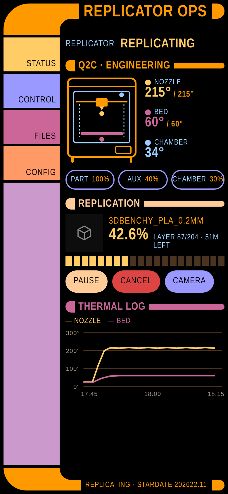
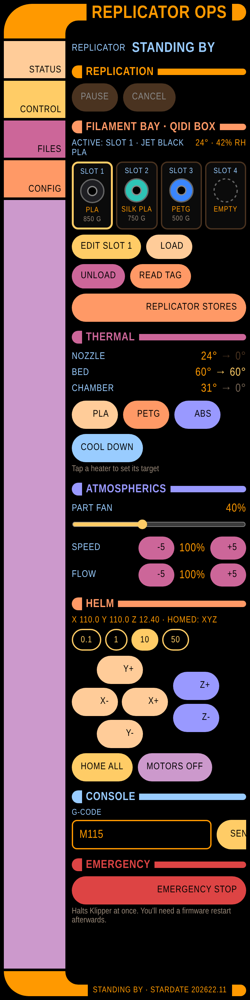
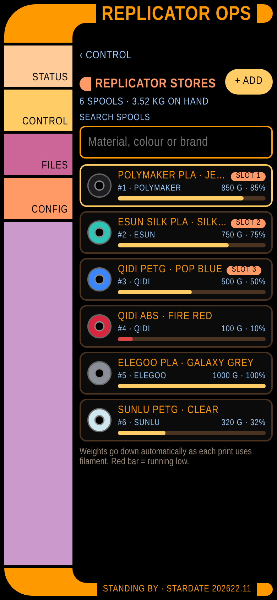
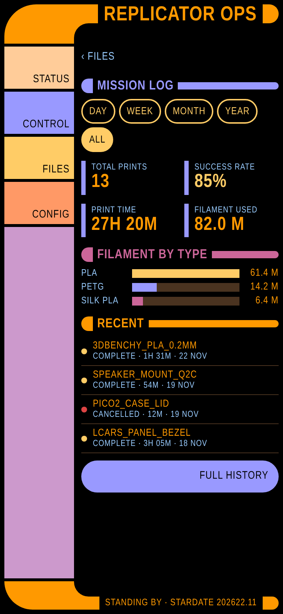
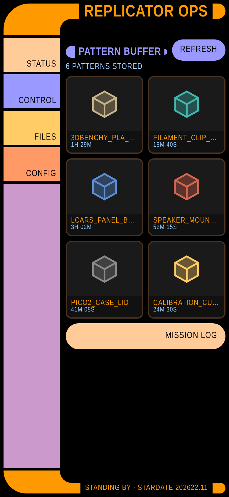
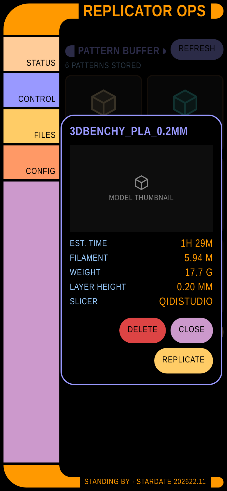
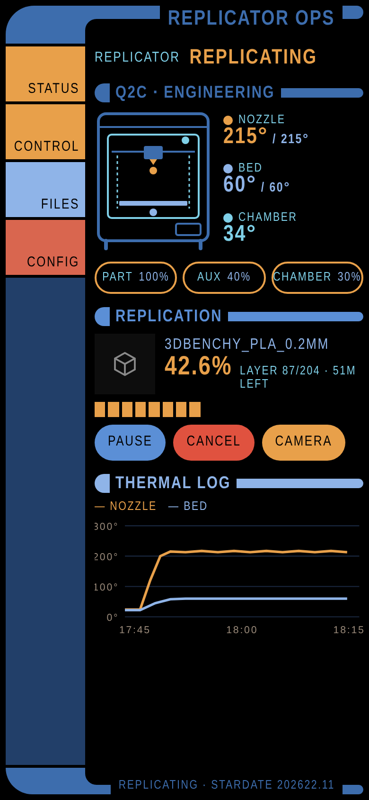
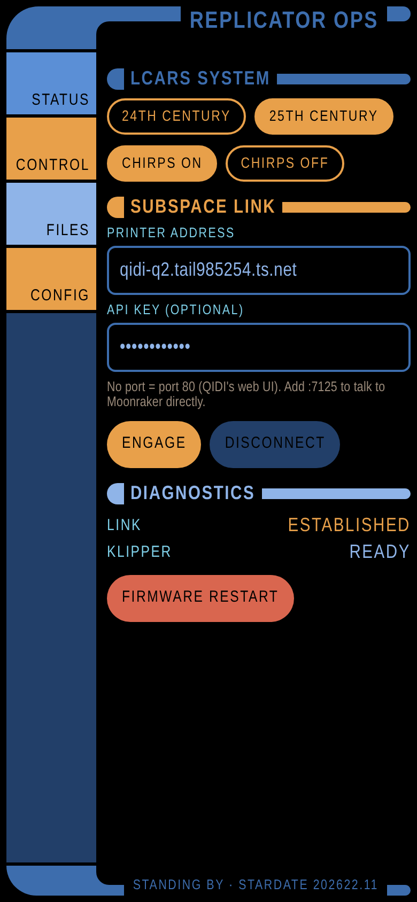

# Replicator Ops

**[Download the latest APK](../../releases/latest)**

An open-source, LCARS-styled Android app for controlling QIDI (and other Klipper/Moonraker) 3D printers. It's a clean-room alternative to QIDI Maker: it talks straight to the printer's **Moonraker** API over your LAN or Tailscale, with no account or cloud needed.

> Not affiliated with QIDI Tech or Paramount. "LCARS" styling is an original fan interpretation.

## Screens

Design mockups with example data. See [all screens](docs/mockups/png), or open the HTML versions in [`docs/mockups`](docs/mockups).

| Status | Control | Replicator stores | Mission log |
|---|---|---|---|
|  |  |  |  |

| Files | File details | Status · 25th Century | Config · 25th Century |
|---|---|---|---|
|  |  |  |  |

## Features (v0.2)

- **Status:** LCARS line drawing of the Q2C with nozzle, bed and chamber temperatures beside it, fan speeds, current print (thumbnail, %, layer, time left), a 30-minute temperature graph, and a Camera button
- **Control:** pause/resume/cancel, heater targets and presets, fan, speed and flow, moving the axes, G-code console, emergency stop
- **Filament bay (QIDI Box):** four slots with colour, type and grams left, plus the Box temperature and humidity. **Edit slot** sets each slot's type and colour, or links it to a spool. Load, Unload and Read tag buttons
- **Replicator stores** (from Control): your spool list with search, add/edit/delete, colour, type, brand, weight, Box slot and "in use". Grams come off automatically when a print ends
- **Files:** thumbnail grid, details, start print, delete
- **Mission log** (from Files): print history from Moonraker with Day/Week/Month/Year/All, success rate, print time, filament by type and recent prints
- **Config:** 24th/25th Century styles, chirps, address/API key, diagnostics, plus raw QIDI Box data
- **Starbase Uplink:** checks GitHub Releases when the app opens (alert chirp if a newer build exists) or on demand, then downloads it with a progress bar and opens Android's installer

### QIDI Box on the Q2C

Mapped from the Q2C's own config and Box firmware modules (`box_extras`, `box_stepper`):
- **Reads (checked live on a Q2C):** `box_extras.boxes[0]` → `aht20_temp`, `aht20_humidity`, `box_target_temp`, `box_inserted_N`, and `filament_info[N]` (`filament_type`, `filament_str`, `color_rgb_str`, `vendor_str`); `box_extras.loaded_slot`. Falls back to `save_variables` (`slotN`, `color_slotN`, `filament_slotN`). Dryer = `heater_generic heater_box1`. Filament ID `QFA00` = QIDI PLA Basic.
- **Part fan:** QIDI uses `fan_generic cooling_fan`, so the slider sends `SET_FAN_SPEED FAN=cooling_fan`.
- **Commands:** Load = `M109` to print temperature then `EXTRUDER_LOAD SLOT=slotN`; Unload = `M109` then `EXTRUDER_UNLOAD SLOT=slotN`; Read tag = `SLOT_RFID_READ SLOT=slotN` (N = 0–3). All three, plus Edit slot colour write-back, are tested on a Q2C with a QIDI Box.
- **Edit slot:** the colour is written to the printer with `SAVE_VARIABLE VARIABLE=color_slotN VALUE="['RRGGBB']"`, which is where the Box firmware reads it. The type stays on the phone, because the printer stores QIDI filament codes and the code list isn't on the printer.
- Config → Diagnostics shows every Box field the printer reports.

## Build

1. Open the project in Android Studio (Ladybug or newer).
2. **Use JDK 17:** Settings → Build, Execution, Deployment → Build Tools → Gradle → Gradle JDK → `jbr-17`. Kotlin 2.0.21 can't build with Android Studio's bundled Java 25.
3. Let it sync (Gradle 8.11.1, AGP 8.7.3, Kotlin 2.0.21), then run on a phone with Android 8.0 or later.

From the command line: `JAVA_HOME=<path to JDK 17> ./gradlew assembleDebug` gives `app/build/outputs/apk/debug/app-debug.apk`.

**Signing:** every build is signed with one fixed key so Starbase Uplink can install updates over the top. CI reads it from the `SIGNING_KEYSTORE_B64`, `SIGNING_STORE_PASSWORD`, `SIGNING_KEY_ALIAS` and `SIGNING_KEY_PASSWORD` secrets; local builds can use a git-ignored `keystore.properties` (`storeFile`, `storePassword`, `keyAlias`, `keyPassword`). Without the key, CI still builds but won't publish a release.

**Automatic builds:** GitHub Actions builds the APK on every push (download it from the run's *Artifacts*). Raising `versionName` in `app/build.gradle.kts` and pushing to `main` publishes a new release with the APK attached.

## Connecting

- At home: enter the printer's IP, e.g. `192.168.1.50`.
- Remotely: enter its Tailscale name, e.g. `qidi-q2.tail985254.ts.net`.
- With no port, the app uses port 80 (QIDI's nginx, which forwards to Moonraker). If that fails, try `:7125`.
- **Tailscale on the Q2C:** the stock `moonraker.conf` only trusts home-network ranges, so add `100.64.0.0/10` under `[authorization] trusted_clients` (then restart Moonraker), or use an API key.
- If you get "Unauthorised", either add an API key (Fluidd → Settings → Authentication) or add your network to `[authorization] trusted_clients` in `moonraker.conf`. For Tailscale, that's `100.64.0.0/10`.

## Project layout

```
app/src/main/java/dev/vantara/replicatorops/
  data/          Moonraker WebSocket JSON-RPC client, state, prefs
  ui/lcars/      LCARS styles, frame/elbows, buttons, chirps
  ui/screens/    Status, Control, Files, Config, camera view
docs/qidi-maker-inspection.md   Notes from inspecting QIDI Maker 1.1.3
```

## Ideas for later

SSDP printer discovery (QIDI's search target is in the notes), writing slot info back to the printer, case light, timelapse toggle, noodle-detection settings, MJPEG streaming, multiple printers, an Antonio font in `res/font`.

## License

Replicator Ops is free software under the [GNU General Public License v3.0](LICENSE). You can use, study, change and share it; anything you distribute that is based on it must also be released under GPL-3.0 with its source code.

Not affiliated with QIDI Tech or Paramount.
